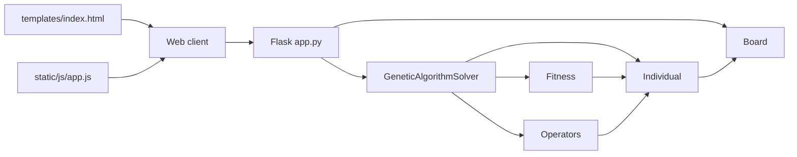

# N-Puzzle Genetic Solver

Projeto acadêmico em Python para investigar a aplicação de algoritmos genéticos na resolução do problema N-Puzzle. O sistema combina representação do tabuleiro, avaliação de indivíduos, operadores genéticos e interface web em Flask para testar a evolução de sequências de movimentos até a resolução do quebra-cabeça.

## Funcionalidades

- suporte a tabuleiros 3×3 e 4×4;
- representação do estado do puzzle e validação de movimentos;
- geração de tabuleiros aleatórios solucionáveis;
- algoritmo genético com população, seleção por torneio, crossover, mutação e elitismo;
- cálculo de fitness baseado em distância Manhattan, movimentos inválidos e comprimento do cromossomo;
- API Flask com rotas para geração de tabuleiros e resolução do problema;
- interface web em HTML, CSS e JavaScript para configurar parâmetros e reproduzir a solução;
- scripts e CSVs para análise experimental de sucesso, convergência e custo computacional.

## Tecnologias utilizadas

- Python 3
- Flask
- HTML, CSS e JavaScript
- pytest para testes automatizados
- CSV e scripts Python para coleta de dados experimentais

## Arquitetura resumida



Os principais módulos são:

- `app.py`: interface HTTP e validação da entrada;
- `puzzle/board.py`: tabuleiro e regras do problema;
- `genetic_algorithm/individual.py`: representação dos indivíduos;
- `genetic_algorithm/fitness.py`: avaliação da aptidão;
- `genetic_algorithm/operators.py`: operadores genéticos;
- `genetic_algorithm/solver.py`: orquestração da evolução;
- `templates/` e `static/`: interface web;
- `tests/`: testes automatizados;
- `experiments/`: scripts e resultados experimentais.

## Requisitos

- Python 3.10 ou superior é a referência mais provável para o ambiente do projeto, conforme a implementação atual.
- Dependência principal registrada: `Flask>=3.0,<4.0` em `requirements.txt`.
- O projeto também depende de bibliotecas padrão do Python e das ferramentas de teste do pytest.

## Instalação

No Windows, use:

```powershell
python -m venv .venv
.\.venv\Scripts\Activate.ps1
pip install -r requirements.txt
```

Em Linux/macOS, equivalente:

```bash
python -m venv .venv
source .venv/bin/activate
pip install -r requirements.txt
```

## Como executar

A aplicação Flask pode ser iniciada com o comando:

```bash
python app.py
```

Em seguida, a aplicação estará disponível em:

- http://127.0.0.1:5000/

## Como utilizar

1. Abra a interface em `/`.
2. Escolha o tamanho do tabuleiro, 3×3 ou 4×4.
3. Gere um tabuleiro aleatório ou informe um estado válido.
4. Ajuste os parâmetros do algoritmo, se necessário.
5. Clique em `Resolver`.
6. Observe a evolução das métricas e, se houver solução, a sequência de movimentos gerada para reprodução.

A resolução também pode ser realizada diretamente via API, conforme detalhado na documentação técnica.

## API

Rotas implementadas e confirmadas no código:

- `GET /`: entrega a interface web;
- `GET /random?size=3` ou `GET /random?size=4`: gera um tabuleiro aleatório solucionável;
- `POST /solve`: resolve um tabuleiro enviado em JSON.

Exemplo de requisição:

```json
{
  "size": 3,
  "state": [1, 2, 3, 4, 5, 6, 7, 0, 8],
  "population_size": 10,
  "initial_chromosome_length": 6,
  "crossover_rate": 0.7,
  "mutation_rate": 0.2,
  "tournament_size": 2,
  "elites_count": 1,
  "max_chromosome_length": 20,
  "max_generations": 10,
  "time_limit": 3.0,
  "random_seed": 7
}
```

## Resultados experimentais

Os resultados persistidos em `experiments/results` indicam que o baseline contém 21 execuções. Foram observadas 9 soluções e uma taxa de sucesso aproximada de 42,86%.

Resumo dos dados registrados:

- 3x3 resolvido: 3/3 soluções
- 3x3 a um movimento do objetivo: 3/3 soluções
- 3x3 médio: 3/3 soluções
- 3x3 difícil: 0/9 soluções
- 4x4: 0/9 soluções

Esses números foram extraídos dos CSVs existentes e não devem ser interpretados como garantia de performance em outras instâncias ou configurações.

## Testes

O projeto inclui testes automatizados em `tests/` para tabuleiro, fitness, operadores, solver e rotas web. Para executar a suíte localmente, use:

```bash
pytest
```

Não foram executados testes durante a criação desta documentação.

## Limitações conhecidas

- o algoritmo é heurístico e não garante solução ótima;
- o desempenho depende fortemente dos parâmetros e da semente aleatória;
- em cenários mais difíceis e em 4x4, os resultados observados no baseline não convergem de forma consistente;
- o valor de fitness não deve ser interpretado como probabilidade de sucesso;
- o algoritmo depende de orçamento computacional e de limite de gerações/tempo.

## Documentação completa

- [docs/TECHNICAL_DOCUMENTATION.md](docs/TECHNICAL_DOCUMENTATION.md)

## Licença

Este projeto usa a licença MIT, conforme o arquivo [LICENSE](LICENSE).

## Contexto acadêmico

O projeto foi desenvolvido como estudo de aplicação de algoritmos genéticos a problemas combinatórios, com foco na representação de soluções, avaliação de indivíduos, operadores evolutivos e análise experimental do comportamento do algoritmo em instâncias do N-Puzzle.
