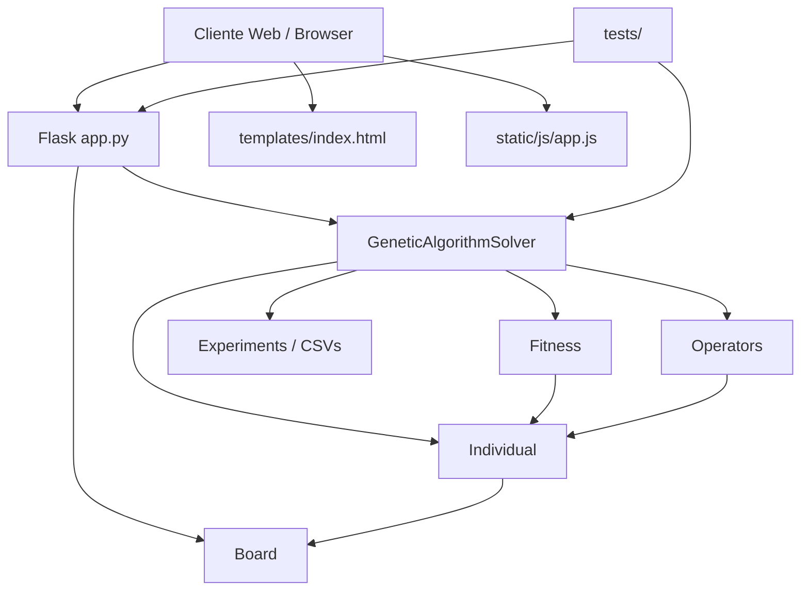
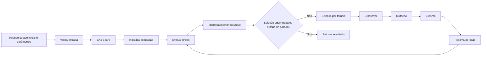

# Documentação técnica do N-Puzzle Genetic Solver

## 3.1. Visão geral

O N-Puzzle é um problema de rearranjo de peças em um tabuleiro com uma célula vazia. O objetivo é ordenar as peças até atingir o estado objetivo, movendo a célula vazia para posições adjacentes. Neste projeto, o problema é modelado em Python por meio da classe `Board`, que representa o estado atual, valida movimentos, calcula a distância Manhattan e gera tabuleiros solucionáveis a partir do estado objetivo.

O projeto N-Puzzle Genetic Solver busca resolver instâncias do problema usando um algoritmo genético manual, sem bibliotecas especializadas de otimização evolutiva. A abordagem consiste em:

- representar uma solução potencial como uma sequência de movimentos;
- avaliar cada sequência por uma função de aptidão;
- selecionar os melhores indivíduos;
- combinar e mutar cromossomos;
- repetir o procedimento até atingir uma condição de parada.

Os objetivos acadêmicos e técnicos do projeto incluem investigar a aplicabilidade de algoritmos evolutivos em problemas combinatórios, medir a convergência e a reprodutibilidade, observar o comportamento da população e documentar a relação entre representação, avaliação e evolução.

As limitações da abordagem são evidentes no código e nos dados experimentais: o algoritmo é heurístico, não garante solução ótima, não garante solução dentro do orçamento de busca e depende fortemente dos parâmetros configurados, da semente aleatória e da dificuldade da instância.

## 3.2. Arquitetura do sistema

A arquitetura do projeto é composta por módulos com responsabilidades bem separadas:

- `app.py`: aplicação Flask, validação de entradas e rotas HTTP;
- `puzzle/board.py`: representação do tabuleiro e regras de movimento;
- `genetic_algorithm/individual.py`: representação dos indivíduos e simulação do cromossomo;
- `genetic_algorithm/fitness.py`: cálculo da aptidão;
- `genetic_algorithm/operators.py`: seleção, crossover, mutação e elitismo;
- `genetic_algorithm/solver.py`: orquestração do algoritmo genético;
- `templates/index.html`: interface web;
- `static/js/app.js`: lógica do cliente para interação com o backend;
- `static/css/styles.css`: estilos da interface;
- `tests/`: testes automatizados;
- `experiments/`: scripts e dados de análise experimental.

### Diagrama de arquitetura



### Fluxo principal de execução



## 3.3. Modelagem do problema N-Puzzle

A classe `Board` em `puzzle/board.py` representa um tabuleiro com dimensão `size` e um estado linear representado por uma lista de inteiros. O valor `0` representa a célula vazia. O objetivo para um tabuleiro `n x n` é sempre:

- 3x3: `[1, 2, 3, 4, 5, 6, 7, 8, 0]`
- 4x4: `[1, 2, 3, ..., 15, 0]`

A representação do tabuleiro é linear, em ordem row-major. A célula vazia tem papel central porque todos os movimentos válidos consistem em trocar a posição do zero com uma célula adjacente.

### Movimentos permitidos

Os movimentos suportados são exatamente:

- `U` (up)
- `D` (down)
- `L` (left)
- `R` (right)

A validação é implementada em `Board.move()`. O método:

- exige que o argumento seja uma string;
- converte para maiúsculas;
- aceita somente `U`, `D`, `L` e `R`;
- verifica se o movimento é válido pela posição da célula vazia;
- retorna `False` para movimentos fora dos limites;
- troca as posições apenas quando o movimento é legal.

### Distância de Manhattan

A função `Board.manhattan_distance()` calcula a soma dos deslocamentos de cada peça não vazia até sua posição final no estado objetivo. No código do projeto, a peça `v` é comparada com sua posição esperada em `goal_state()`, em que o valor 1 deve ir para o índice 0, o valor 2 para o índice 1, e assim por diante. A fórmula equivalente implementada é:

$$
\sum_{v=1}^{n^2-1} \left( |r(v) - r^*(v)| + |c(v) - c^*(v)| \right)
$$

onde `r(v)` e `c(v)` são as coordenadas atuais da peça `v`, enquanto `r^*(v)` e `c^*(v)` são as coordenadas esperadas no estado objetivo. A peça zero é ignorada porque representa a célula vazia e não corresponde a uma peça que precise ser deslocada até uma posição objetivo.

Em Python a lógica é exatamente esta:

```python
for index, value in enumerate(self.state):
    if value == 0:
        continue

    goal_index = value - 1
    current_row, current_col = divmod(index, self.size)
    goal_row, goal_col = divmod(goal_index, self.size)
    total += abs(current_row - goal_row) + abs(current_col - goal_col)
```

### Geração de tabuleiros aleatórios solucionáveis

O método `Board.random_solvable(size, shuffle_moves)` gera um tabuleiro legalmente solucionável partindo do objetivo e aplicando movimentos válidos aleatórios, evitando desfazer imediatamente o último movimento. Essa estratégia reduz embaralhamentos redundantes e preserva a solvabilidade do tabuleiro, embora não garanta que a instância será fácil para o algoritmo genético.

### Diferenças entre 3×3 e 4×4

A implementação suporta `size` igual a 3 ou 4. A principal diferença está na dimensão do estado e no número de peças. A validação em `Board` exige que cada tabuleiro tenha exatamente `size * size` peças, todas únicas, de 0 a `size * size - 1`.

## 3.4. Representação dos indivíduos e cromossomos

No módulo `genetic_algorithm/individual.py`, um `Individual` representa uma sequência de movimentos aplicados ao tabuleiro inicial. O cromossomo é uma sequência ordenada, por exemplo:

- `['R', 'D', 'L']`
- `['U', 'U', 'R']`

Os movimentos são validados contra o conjunto `{'U', 'D', 'L', 'R'}` e normalizados para letras maiúsculas. O indivíduo guarda também uma cópia do tabuleiro inicial, com o qual a sequência será simulada. Esse desenho evita que a simulação altere o tabuleiro original.

### Simulação do cromossomo

O método `simulate()`:

1. cria uma cópia do tabuleiro inicial;
2. percorre cada movimento do cromossomo;
3. tenta aplicar o movimento em `board.move(move)`;
4. incrementa `invalid_moves` quando o movimento é inválido;
5. registra o estado final, a distância Manhattan, se a solução foi encontrada e o número de movimentos tentados.

Assim, o cromossomo representa uma estratégia de ações, não diretamente o estado do tabuleiro. A simulação transforma a estratégia em um estado final.

### Exemplo simples

Se o tabuleiro inicial for:

```python
[1, 2, 3, 4, 5, 6, 7, 0, 8]
```

e o cromossomo for:

```python
['R']
```

a simulação move a célula vazia para a direita e produz:

```python
[1, 2, 3, 4, 5, 6, 7, 8, 0]
```

ou seja, o tabuleiro é resolvido. O resultado também registra `invalid_moves` e `manhattan_distance`.

## 3.5. Função de fitness

A função de aptidão está em `genetic_algorithm/fitness.py` e, no código atual, a estrutura é a seguinte.

Para um indivíduo resolvido:

$$
F = 10^9 + \frac{1}{1 + \alpha \cdot iv + \beta \cdot L}
$$

Para um indivíduo não resolvido:

$$
F = \frac{10^6}{1 + d} + \frac{10^4}{1 + \alpha \cdot iv} + \frac{100}{1 + \beta \cdot L}
$$

Onde:

- `d`: distância de Manhattan do estado final;
- `iv`: número de movimentos inválidos;
- `L`: comprimento do cromossomo;
- `\alpha`: peso do termo de movimentos inválidos;
- `\beta`: peso do termo de comprimento do cromossomo.

Os valores confirmados no código são `alpha = 1.0` e `beta = 0.01`.

### Como a fitness é calculada

O método `Fitness.evaluate(individual)`:

1. verifica que o argumento é `Individual`;
2. chama `individual.evaluate()`;
3. extrai `manhattan_distance`, `invalid_moves` e `solved`;
4. usa `len(individual)` como comprimento do cromossomo;
5. aplica a fórmula acima.

A comparação entre indivíduos é feita pela maximização do valor de fitness.

### Efeito da distância de Manhattan

O termo

$$
\frac{10^6}{1 + d}
$$

faz com que estados mais próximos do objetivo recebam valor maior. Menor distância Manhattan significa fitness maior. Isso é coerente com a lógica da busca, mas não é garantia de solução.

### Penalização por movimentos inválidos

O termo

$$
\frac{10^4}{1 + \alpha \cdot iv}
$$

penaliza indivíduos que tentam movimentos indevidos. A penalização é monotonicamente decrescente em `iv`, ou seja, quanto mais inválidos, menor o valor do termo.

### Efeito do comprimento do cromossomo

O termo

$$
\frac{100}{1 + \beta \cdot L}
$$

reduz a fitness quando o cromossomo cresce. Isso favorece soluções mais curtas, observando a mesma ordem de prioridade da distância e dos movimentos inválidos.

### Prioridade da solução

Quando `solved == True`, o código faz:

$$
F = 10^9 + \frac{1}{1 + \alpha \cdot iv + \beta \cdot L}
$$

Esse bônus enorme dá prioridade explícita a um indivíduo que resolve o tabuleiro. Em outras palavras, um estado solucionado domina todos os valores de fitness atribuídos a estados não resolvidos.

### Maximização da fitness

O algoritmo usa maximização. Em `operators.py`, a seleção por torneio usa `max(candidates, key=evaluator)`, e o elitismo ordena a população com `sorted(..., reverse=True)`. O solver também mantém o melhor indivíduo usando comparação em ordem crescente de fitness. Portanto, maior fitness é sempre interpretado como melhor indivíduo.

### Limitações da função de fitness

As limitações desta função são demonstráveis no próprio código:

- a função prioriza solução resolvida por um bônus muito grande, o que pode tornar o valor mais sensível à solução do que às diferenças sutis de distância;
- a avaliação depende do estado final, e não de um histórico das ações ou da semântica do caminho;
- moviementos inválidos são contabilizados, mas não reparametrizados por contexto; a penalização é proporcional ao número observado;
- a função não prova que um indivíduo é ótimo, apenas que ele é melhor em uma escala específica de avaliação.

## 3.6. Operadores genéticos

### Seleção por torneio

A seleção por torneio está em `genetic_algorithm/operators.py`.

- `tournament_size` valida que seja um inteiro positivo e menor ou igual ao tamanho da população.
- `population` é amostrada aleatoriamente, com `rng.randrange(len(population))` para definir candidatos.
- o vencedor é `max(candidates, key=evaluator)`, ou seja, o indivíduo com maior fitness.

O efeito de `tournament_size` é controlar quantos indivíduos são comparados em cada torneio. Quanto maior o tamanho do torneio, maior o conjunto de candidatos potencialmente comparados antes da seleção.

### Crossover

O crossover implementado é de ponto único. O método recebe dois pais e monta dois filhos:

- `cut_a` e `cut_b` são sorteados individualmente para cada pai;
- `child_a` recebe a parte inicial de `parent_a` até `cut_a` e a parte final de `parent_b` a partir de `cut_b`;
- `child_b` recebe a parte inicial de `parent_b` até `cut_b` e a parte final de `parent_a` a partir de `cut_a`.

O código exige que os pais compartilhem o mesmo tabuleiro inicial, porque o filho é criado com um `initial_board` compatível. Isso é validado em `crossover()`:

- `board_a.size == board_b.size`
- `board_a.state == board_b.state`

Cromossomos de comprimentos diferentes são tratados naturalmente porque os pontos de corte são calculados separadamente para cada pai. O código não padroniza o tamanho dos pais antes do crossover. O mesmo vale para pais vazios e cromossomos curtos; a operação continua funcionando quando as listas são curtas ou vazias.

### Mutação

A mutação é implementada em `mutate()`, e as operações confirmadas são:

- substituição:
  - troca um movimento por outro diferente, escolhendo uma alternativa de `ORDERED_MOVES`;
- inserção:
  - insere um movimento aleatório em uma posição aleatória;
- remoção:
  - remove um movimento aleatório.

A lógica da mutação é:

- a taxa é aplicada por indivíduo;
- se `mutation_rate == 0` ou um número aleatório for maior que `mutation_rate`, o indivíduo é devolvido inalterado;
- caso contrário, a operação escolhida é aplicada sobre uma cópia do indivíduo.

`max_chromosome_length` é aplicado em várias etapas:

- se o cromossomo exceder o limite, a cauda é removida;
- na inserção, quando o limite for alcançado, a operação não aumenta o tamanho além do máximo;
- o resultado final é truncado para o limite configurado.

Cromossomos vazios são tratados sem erro quando a mutação é de inserção; a operação cria um novo movimento e o tamanho passa a 1.

### Elitismo

O elitismo é implementado em `elitism()`.

- os indivíduos são ordenados por fitness em ordem decrescente;
- os melhores `keep_count` são selecionados;
- o resultado é uma lista de cópias independentes dos melhores indivíduos.

`elites_count` define quantos indivíduos são preservados e passados diretamente para a próxima geração. Como os indivíduos são copiados com `.copy()`, a população atual e a população seguinte não compartilham a mesma instância em memória.

## 3.7. Fluxo de evolução do algoritmo genético

O fluxo de evolução está em `GeneticAlgorithmSolver.solve()` e no método `_evolve_population()`.

1. Inicialização: a população é criada com indivíduos aleatórios baseados na `initial_chromosome_length` e no tabuleiro inicial.
2. Avaliação da população: cada indivíduo é avaliado por `self.fitness.evaluate(individual)`.
3. Registro das métricas: as estatísticas da geração são computadas em `_generation_metrics()`.
4. Melhor indivíduo: o melhor da geração é identificado por `max(evaluations, key=lambda item: item[1])`.
5. Verificação de parada: o código identifica se o indivíduo atual está resolvido, se atingiu `max_generations` ou se o tempo excedeu o limite.
6. Preservação dos elites: `elitism()` seleciona os melhores indivíduos para a próxima geração.
7. Seleção dos pais: `tournament_selection()` escolhe os indivíduos de cada geração.
8. Crossover: os pais geram filhos por recombinação.
9. Mutação: os filhos sofrem mutação aleatória conforme `mutation_rate` e `max_chromosome_length`.
10. Formação da próxima população: o algoritmo reúne elites e filhos até completar `population_size`.
11. Deduplicação e preenchimento: indivíduos duplicados são removidos e, quando necessário, novos indivíduos aleatórios são gerados para completar o tamanho da população.
12. Reavaliação: o processo se repete na geração seguinte.

A população seguinte é formada como uma mistura de elites e descendentes, preservando os melhores indivíduos e mantendo diversidade através de cruzamentos e mutações.

## 3.8. Parâmetros de configuração

Os parâmetros reais do algoritmo são validados em `GeneticAlgorithmSolver.__init__()` e em `app._validate_solver_config()`. A tabela abaixo mostra os nomes, valores padrão confirmados e efeito real no código.

| Parâmetro | Significado | Valor padrão confirmado | Efeito no algoritmo |
| --- | --- | --- | --- |
| `population_size` | tamanho da população | 20 | quantidade de indivíduos em cada geração |
| `initial_chromosome_length` | comprimento inicial de cada cromossomo | 10 | tamanho inicial da sequência aleatória |
| `crossover_rate` | probabilidade de crossover | 0.8 | frequência de recombinação entre pais |
| `mutation_rate` | probabilidade de mutação por indivíduo | 0.1 | chance de aplicar operação de mutação |
| `tournament_size` | tamanho do torneio | 3 | número de candidatos usados na seleção |
| `elites_count` | quantidade de elites preservadas | 2 | número de melhores indivíduos copiados diretamente |
| `max_chromosome_length` | limite máximo do cromossomo | 50 | truncamento e proteção de comprimento |
| `max_generations` | limite de gerações | 100 | critério máximo de iterações |
| `time_limit` | limite de tempo em segundos | `None` | parada por tempo, se configurado |
| `random_seed` | semente aleatória | `None` | define a sequência do gerador `random.Random` |

Os parâmetros usados nos scripts experimentais podem diferir dos valores padrão do solver; isso foi comprovado diretamente nos CSVs gerados em `experiments/results`.

## 3.9. Critérios de parada

As condições de parada efetivamente implementadas em `GeneticAlgorithmSolver.solve()` são:

1. `initial_board.is_solved()`: quando o tabuleiro inicial já está resolvido, o algoritmo retorna imediatamente.
2. `current_best_result["solved"]`: quando um indivíduo da geração atual resolve o tabuleiro, a busca termina com `stop_reason = "solved"`.
3. `generation + 1 >= self.max_generations`: limite máximo de gerações.
4. `self._time_limit_reached(start_time)`: limite de tempo.
5. `not evaluations`: quando a população não foi avaliada, a execução interrompe com motivo de tempo ou falha de avaliação.

O valor de `stop_reason` é retornado no JSON final do solver e pode ser `solved`, `max_generations`, `time_limit` ou, em algumas condições de falha de avaliação, outros caminhos específicos do fluxo. O código documentado também trata `history` com entradas marcadas como `partial=True` quando a geração é interrompida pelo tempo.

## 3.10. Reprodutibilidade

A reprodutibilidade depende diretamente do uso de `random_seed` no construtor de `GeneticAlgorithmSolver`:

```python
self.rng = random.Random(random_seed)
```

Esse gerador é compartilhado por:

- população inicial;
- seleção por torneio;
- crossover;
- mutação;
- preenchimento dos indivíduos após deduplicação.

As condições necessárias para reprodução são:

- mesmo código;
- mesmo estado inicial do tabuleiro;
- mesmos parâmetros do solver;
- mesma semente aleatória;
- mesmo ambiente de execução no que toca ao limite de tempo.

A implementação e os testes confirmam que, com mesma semente e configurações idênticas, duas execuções podem produzir resultados iguais. Contudo, o limite de tempo introduz uma dependência do ambiente de execução, portanto a reprodutibilidade perfeita não é garantida em todos os cenários.

## 3.11. API e integração web

A aplicação Flask em `app.py` define as rotas principais.

### `GET /`

- método: `GET`
- objetivo: entregar a página HTML da interface web
- retorno: renderização do template `templates/index.html`

### `GET /random`

- método: `GET`
- objetivo: gerar um tabuleiro aleatório solucionável para um tamanho informado
- parâmetros: `?size=3` ou `?size=4`
- retorno JSON: `{ "size": 3, "state": [...] }`
- validações: aceita apenas `3` ou `4`

### `POST /solve`

- método: `POST`
- objetivo: resolver um problema enviado pelo cliente
- parâmetros esperados: `size`, `state`, e opcionalmente todos os parâmetros do solver
- retorno: JSON com `solved`, `stop_reason`, `best_sequence`, `final_state`, `history`, etc.
- validações: estado deve ter tamanho correto e ser uma permutação válida de 0 a `size*size - 1`; parâmetros do solver da API são validado por `_validate_solver_config()`.

Exemplo de requisição JSON:

```json
{
  "size": 3,
  "state": [1, 2, 3, 4, 5, 6, 7, 0, 8],
  "population_size": 10,
  "initial_chromosome_length": 6,
  "crossover_rate": 0.7,
  "mutation_rate": 0.2,
  "tournament_size": 2,
  "elites_count": 1,
  "max_chromosome_length": 20,
  "max_generations": 10,
  "time_limit": 3.0,
  "random_seed": 7
}
```

Exemplo de resposta JSON:

```json
{
  "solved": true,
  "solution": ["R"],
  "best_sequence": ["R"],
  "final_state": [1, 2, 3, 4, 5, 6, 7, 8, 0],
  "generations_run": 1,
  "stop_reason": "solved",
  "history": []
}
```

## 3.12. Interface web

A interface web está em `templates/index.html` e usa JavaScript em `static/js/app.js` para interagir com a API.

### Funcionalidades confirmadas

- seleção do tamanho do tabuleiro: 3×3 ou 4×4;
- geração de tabuleiro aleatório com `GET /random`;
- configuração dos parâmetros do algoritmo;
- execução da resolução com o botão `Resolver`;
- visualização do estado atual do tabuleiro;
- exibição de métricas de evolução;
- gráfico SVG de melhor fitness e fitness média;
- reprodução da solução por movimentos;
- controles de iniciar, pausar, retomar, avançar e reiniciar a reprodução;
- ajuste de velocidade da reprodução.

A interface não implementa uma API de monitoramento em tempo real diferente da resposta final do solve; ela funciona como cliente da API Flask e atualiza o estado visual conforme o retorno do servidor.

## 3.13. Testes automatizados

Os testes existentes encontram-se em `tests/` e cobrem:

- `test_board.py`: validação do tabuleiro, movimentos, distância Manhattan, geração solucionável e cópia do estado;
- `test_genetic_core.py`: simulação do indivíduo, fitness, penalização, comparação entre casos e prioridade da solução;
- `test_operators.py`: seleção por torneio, crossover, mutação, elitismo e reprodutibilidade do RNG;
- `test_solver.py`: inicialização, condições de parada, histórico, validação, reprodução por semente e deduplicação;
- `test_web_routes.py`: rotas Flask, validações de entrada e resposta JSON.

Esses testes foram analisados como fonte de comportamento real, mas não foram executados para a criação desta documentação.

## 3.14. Metodologia experimental

Os experimentos estão em `experiments/run_baseline.py` e `experiments/advanced_analysis.py`, e os resultados persistidos em `experiments/results`.

Os parâmetros usados nos experimentos confirmados pelos CSVs são:

- `population_size`: 10
- `initial_chromosome_length`: 6
- `max_generations`: 10 ou 12, conforme o conjunto de resultados
- `crossover_rate`: 0.7
- `mutation_rate`: 0.2
- `tournament_size`: 2
- `elites_count`: 1
- `max_chromosome_length`: 20
- `time_limit`: 3.0 em diversos casos
- sementes: 7, 13, 29, e casos específicos como 42 para reprodutibilidade

### Objetivos dos experimentos

- baseline: verificar taxa de sucesso e comportamento em vários cenários;
- fitness diagnostics: observar a contribuição da fitness em casos específicos;
- convergence runs: observar a evolução da melhor fitness e da distância Manhattan;
- diversity by generation: verificar diversidade de cromossomos e estados finais;
- evaluation cost: medir custo computacional de avaliação e simulação;
- reproducibility check: verificar reprodutibilidade com a mesma semente.

### Limitações metodológicas

- conjunto pequeno de instâncias;
- número limitado de sementes;
- variedade reduzida de parâmetros;
- objetivo de análise exploratória, não de inferência estatística conclusiva;
- ausência de amostragem mais ampla ou de comparativo com algoritmos clássicos.

## 3.15. Resultados experimentais

Os números abaixo foram coletados diretamente dos CSVs em `experiments/results`.

### Baseline

O arquivo `baseline_runs.csv` contém 21 execuções. O número de execuções com solução foi 9, e o total de execuções foi 21.

A taxa de sucesso calculada foi:

$$
\text{Taxa de sucesso} = \frac{9}{21} \times 100 \approx 42.86\%
$$

O resultado por categoria observado foi:

- 3x3 objetivo: 3/3 resolvidos
- 3x3 a um movimento do objetivo: 3/3 resolvidos
- 3x3 médio: 3/3 resolvidos
- 3x3 difícil: 0/9 resolvidos
- 4x4: 0/9 resolvidos

Esses resultados são consistentes com a leitura direta do CSV e não dependem de inferência adicional.

### Tempo e gerações

Os dados indicam:

- cenários 3x3 resolvidos: tempo geralmente muito baixo, na faixa de microssegundos a milissegundos;
- cenários 3x3 difíceis e 4x4: ficam com `stop_reason = max_generations` em todas as execuções observadas;
- duração total em cenários difíceis e 4x4 está na faixa de 0,011 a 0,022 segundos, refletindo o orçamento de busca configurado.

### Comprimento da melhor sequência e Manhattan final

Nos CSVs de convergência e baseline, a melhor sequência normalmente tem tamanho variando de 2 a 20 movimentos em execuções não resolvidas e 0 a 6 em execuções resolvidas. Em casos resolvidos, `best_manhattan_distance` é `0` e o estado final coincide com o objetivo.

### Custo de avaliação

Os dados em `evaluation_cost.csv` mostram:

- 3x3 médio: aproximadamente 279 a 341 chamadas de `evaluate` e 440 a 534 de `simulate`;
- 3x3 difícil e 4x4: aproximadamente 713 chamadas de `evaluate` e 1098 de `simulate`.

Esses números são observados pelos CSVs e representam a sobrecarga da avaliação ao longo da execução.

## 3.16. Reprodutibilidade experimental

O arquivo `reproducibility_check.csv` mostra duas execuções com a mesma semente (`42`), o mesmo tabuleiro inicial e a mesma configuração. Os resultados observados foram:

- `solved = True`
- `stop_reason = solved`
- `generations_run = 5`
- `best_fitness = 1.4901960784313726`
- `best_sequence = ['R', 'L', 'R', 'R']`
- `final_state = [1, 2, 3, 4, 5, 6, 7, 8, 0]`

Isso demonstra que, no caso reportado, a execução foi reprodutível sob a mesma semente e configuração. Porém, isso não estabelece uma garantia universal de que todos os cenários sejam reproduzíveis em todas as máquinas ou em todos os ambientes, especialmente quando o limite de tempo entra em jogo.

## 3.17. Convergência, diversidade e custo computacional

Os CSVs de `diversity_by_generation.csv` e `convergence_runs.csv` registram as seguintes métricas:

- `best_fitness`
- `average_fitness`
- `min_manhattan_distance`
- `best_chromosome_length`
- `distinct_chromosomes`
- `distinct_final_states`
- `duplicate_ratio`
- `stagnation_count`
- `improved_since_previous`
- `calls_evaluate_generation`
- `calls_simulate_generation`

### Evidências observadas

- em cenários 3x3 médios, há crescimento da melhor fitness e redução da distância Manhattan até a resolução;
- em cenários difíceis e 4x4, a melhora da melhor fitness é limitada e não produz solução em muitos casos;
- a diversidade de estados finais e de cromossomos não garante qualidade da solução; a população pode ser diversa e, ainda assim, permanecer distante do objetivo;
- o custo de avaliação cresce de forma estável ao longo das gerações e é maior para cenários mais difíceis.

### Limitação das métricas

Diversidade não deve ser interpretada como qualidade. O código mede diversidade por cromossomos distintos e estados finais distintos, mas isso não equivale a “melhor busca” nem a solução mais eficiente.

## 3.18. Limitações do projeto

### Limitações verificadas

- representação linear por sequência de movimentos;
- ausência de garantia de solução ótima;
- ausência de garantia de solução dentro do orçamento de busca configurado;
- dependência forte de parâmetros e semente;
- limitação de avaliação final em termos de estado, sem análise profunda do caminho;
- dificuldade em instâncias 3x3 mais complexas e em 4x4;
- uso de um número limitado de cenários experimentais;
- dependência de tempo e de ambiente quando `time_limit` é usado.

### Hipóteses que ainda precisam ser testadas

- variação de `population_size` e máx. de gerações pode mudar significativamente o desempenho;
- aumentos no número de elites ou no tamanho do torneio podem favorecer ou prejudicar a convergência;
- um critério de parada por estagnação pode alterar o comportamento do algoritmo sem depender de `max_generations`; isso não está implementado no código atual.

### Melhorias futuras sugeridas

- comparação sistemática de parâmetros;
- exploração de maior diversidade de sementes e cenários;
- priorização de penalizações mais explícitas para movimentos inválidos;
- uso de critérios de parada por estagnação;
- comparação do algoritmo com algoritmos clássicos de busca, como A*;
- aumento de amostra experimental e análise estatística.

Essas sugestões devem ser entendidas como trabalhos futuros e não como funcionalidade implementada.

## 3.19. Melhorias futuras

As melhorias futuras coerentes com o projeto incluem:

- otimização da função de fitness para comparar melhor estados próximos do objetivo;
- estudo de parâmetros do algoritmo em um espaço mais amplo;
- adição de critérios de parada por estagnação ou melhoria mínima;
- redução de movimentos inválidos e ciclos redundantes;
- uso de melhor diagnóstico de diversidade e convergência;
- comparação com A* e outras heurísticas clássicas;
- expansão dos cenários experimentais para instâncias maiores e com mais sementes.

Essas propostas não fazem parte da implementação atual.

## 3.20. Conclusão técnica

O N-Puzzle Genetic Solver implementa uma solução heurística, em Python, para o problema N-Puzzle por meio de algoritmo genético manual. A arquitetura separa bem o problema do modelo de resolução: `Board` cuida do tabuleiro, `Individual` representa uma sequência de movimentos, `Fitness` mede a qualidade do indivíduo, `operators.py` implementa a reprodução e `solver.py` orquestra a evolução.

Os dados experimentais confirmam que o algoritmo resolve rapidamente problemas simples e quase-resolvidos em 3x3, mas tem desempenho limitado em cenários mais difíceis e em 4x4 sob os parâmetros testados. A reprodutibilidade é verificável com semente fixa, mas a solução não é garantida e depende do conjunto de parâmetros e da instância.

O baseline atua como referência útil para futuras melhorias e para comparações de qualidade. O projeto é plenamente útil como estudo acadêmico, ferramenta de investigação e protótipo experimental, mas não deve ser interpretado como uma solução geral, garantida e ótima para todos os casos do N-Puzzle.
